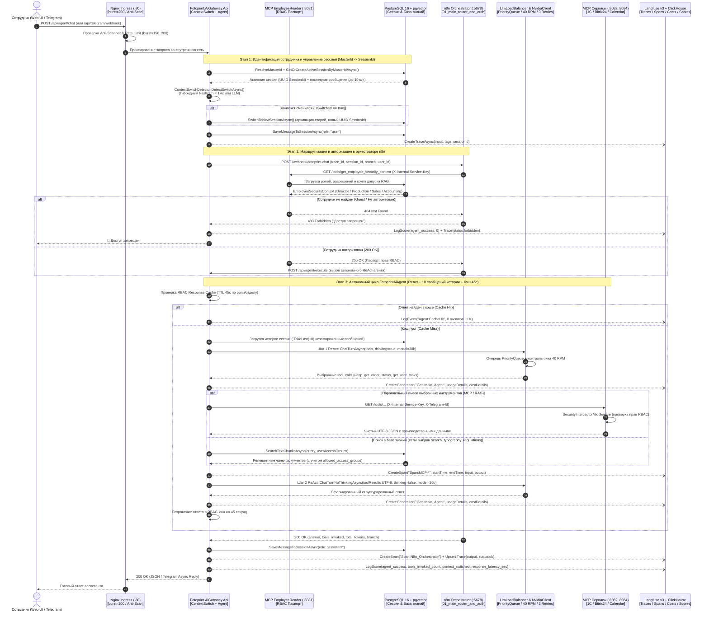

# 🖨️ Fotoprint AI Copilot

**Fotoprint AI Copilot** — интеллектуальная мультиагентная платформа и корпоративный AI-ассистент типографии полного цикла («Фотопринт») на базе моделей семейства **NVIDIA Nemotron 3.5** (`nvidia/nemotron-3.5-lightning-30b-a3b` и `nvidia/nemotron-3.5-super-vl-120b-a12b`).

Система автоматизирует:
- подготовку к ежедневным планеркам и протоколирование совещаний (**Minutes of Meeting / DOCX**);
- оперативный контроль тиражей, выработки и процента брака в **1С:Управление нашей типографией**;
- управление поручениями и сделками в **CRM Битрикс24** и проверку расписания в **Корпоративном календаре**;
- гибридный и векторный поиск по технологическим регламентам и базе знаний с жестким разграничением прав доступа (**RBAC RAG на базе PostgreSQL 16 + pgvector**);
- сквозную наблюдаемость, расчет стоимости токенов (**FinOps**) и мониторинг качества в **Langfuse v3** (ClickHouse + PostgreSQL + Redis + MinIO).

---

## 🏗 Архитектура системы

Платформа построена на микросервисной контейнеризированной архитектуре с защищенным внутренним периметром MCP-серверов и автоматическим туннелированием вебхуков Telegram через **Cloudflare Quick Tunnel (`cloudflared`)**:

```text
             ┌──────────────────────────────┐     ┌──────────────────────────────┐
             │   Telegram Bot API (Cloud)   │     │   Web Copilot UI (Browser)   │
             └──────────────┬───────────────┘     └──────────────┬───────────────┘
                            │ (HTTPS Quick Tunnel)               │ (HTTP :80)
                            ▼                                    │
             ┌──────────────────────────────┐                    │
             │    fotoprint-cloudflared     │                    │
             └──────────────┬───────────────┘                    │
                            └─────────────────┬──────────────────┘
                                              ▼
    ┌────────────────────────────────────────────────────────────────────────────┐
    │               ЕДИНАЯ ТОЧКА ВХОДА: NGINX Ingress Load Balancer              │
    │  • Защита от сканеров портов и ботов (Anti-Scanner 444 Drop & Honeypots)   │
    │  • Блокировка прямого внешнего доступа к /tools и /mcp (403 Forbidden)     │
    │  • Буферизация пиковых нагрузок: burst=200 (Telegram) / burst=150 (Web API)│
    └─────────────────────────────────────────┬──────────────────────────────────┘
                                              │ (Внутренняя сеть fotoprint-net)
                                              ▼
    ┌────────────────────────────────────────────────────────────────────────────┐
    │                     Fotoprint.AiGateway.Api (.NET 9, :8080)                │
    │  • TelegramWebhookProcessor (мгновенный 200 OK, дедупликация, typing)      │
    │  • Гибридный ContextSwitchDetector (FastPath < 1мс + LLM Fallback)         │
    │  • FotoprintAiAgent (история до 10 сообщений, RBAC-кэш 45с, ReAct агент)   │
    │  • LlmLoadBalancer (PriorityQueue + сглаживание 40 RPM) & RollbackManager  │
    └──────────────┬──────────────────────────┬──────────────────────────┬───────┘
                   │                          │                          │
                   ▼                          ▼                          ▼
        ┌─────────────────────┐    ┌─────────────────────┐    ┌─────────────────────┐
        │   n8n Orchestrator  │    │   PostgreSQL 16     │    │    Langfuse v3      │
        │  (6 AI Workflows)   │    │   + pgvector (RAG)  │    │  + ClickHouse OLAP  │
        │      Порт 5678      │    │   127.0.0.1:5432    │    │      Порт 3000      │
        └──────────┬──────────┘    └─────────────────────┘    └─────────────────────┘
                   │
                   ▼
    ┌────────────────────────────────────────────────────────────────────────────┐
    │               ИЗОЛИРОВАННЫЙ ВНУТРЕННИЙ ПЕРИМЕТР MCP-СЕРВЕРОВ               │
    │  • Порты закрыты от внешнего мира (доступ только внутри fotoprint-net)     │
    │  • InternalServiceAuthMiddleware (проверка X-Internal-Service-Key)         │
    │  • SecurityInterceptorMiddleware (проверка RBAC-разрешений сотрудника)     │
    ├───────────────────┬──────────────────┬──────────────────┬──────────────────┤
    │ EmployeeReader    │ MCP-1C           │ MCP-Bitrix24     │ MCP-Calendar     │
    │ (RBAC/Auth :8081) │ (1С:УНТ :8082)   │ (Задачи/CRM:8083)│ (Встречи :8084)  │
    └───────────────────┴──────────────────┴──────────────────┴──────────────────┘
```

---

## 🔄 Диаграмма последовательности (Sequence Diagram)

Ниже представлена полная последовательность обработки запроса пользователя (от входа через Nginx до вызова оркестратора `n8n`, автономного выбора MCP-инструментов, работы с `LlmLoadBalancer` на 40 RPM и записи телеметрии в `Langfuse v3`):



---

## 🚀 Быстрый старт и управление проектом

### Предварительные требования
- **Docker Desktop** (версия 24+) с поддержкой **Docker Compose v2**.
- Выделенная оперативная память для Docker: рекомендуется **не менее 4–6 ГБ RAM** (PostgreSQL 16, ClickHouse, Redis, MinIO, n8n, Langfuse, .NET микросервисы).
- Для локального запуска тестов вне Docker: **.NET 9 SDK**.

### 1. Настройка `.env`
Скопируйте шаблон переменных окружения и укажите ваш API-ключ NVIDIA NIM (`NVIDIA_API_KEY`) и при необходимости токен Telegram-бота (`TELEGRAM_BOT_TOKEN`):

```powershell
# PowerShell (Windows):
Copy-Item .env.example .env
```

```bash
# Bash (Linux / macOS):
cp .env.example .env
```

> 💡 **Поддержка пула API-ключей (Key Rotation):** В переменной `NVIDIA_API_KEY` (или `NVIDIA_API_KEYS`) можно указать несколько ключей через запятую (`nvapi-key1,nvapi-key2,nvapi-key3`). `NvidiaClient` автоматически распределяет запросы между ними по алгоритму `Round-Robin`, кратно увеличивая лимит RPM (`2 ключа = 80 RPM`, `3 ключа = 120 RPM`).

### 2. Запуск всего стека
```bash
docker compose up -d --build
```

Проверка статуса всех контейнеров:
```bash
docker compose ps
```

### 3. Пересборка только AI Gateway после изменений в коде .NET
```bash
docker compose up -d --build --no-deps ai-gateway
docker restart fotoprint-nginx
```

### 4. Остановка проекта
```bash
# Штатная остановка с сохранением всех данных:
docker compose stop

# Остановка и удаление контейнеров (тома БД сохраняются):
docker compose down

# Полный сброс вместе с томами БД (Fresh Install):
docker compose down -v
```

---

## 🌐 Веб-интерфейсы и точки входа

| Сервис | URL | Назначение | Учетные данные (Dev) |
| :--- | :--- | :--- | :--- |
| **Web Copilot UI (через Nginx)** | [http://localhost](http://localhost) (`:80`) | Веб-чат сотрудника с переключением ролей (Директор, Производство, Продажи, Бухгалтерия, Гость), голосовой ввод (STT) и быстрые сценарии | — |
| **Langfuse v3 UI** | [http://localhost:3000](http://localhost:3000) | Дашборд трейсов, стоимости моделей (`$`), задержек (`Spans`) и оценок (`Scores`) | `admin@fotoprint.ru` / `FotoprintAdmin2026!` |
| **n8n Orchestrator** | [http://localhost:5678](http://localhost:5678) | Визуальные воркфлоу маршрутизации, авторизации и фоновых задач | Задаются при входе |
| **MinIO Console** | [http://localhost:9091](http://localhost:9091) | Объектное S3-хранилище событий и батчей Langfuse | `minio` / `minio_secret_password` |
| **Telegram Tunnel Status** | [http://localhost/api/telegram/info](http://localhost/api/telegram/info) | Текущий публичный HTTPS URL Cloudflare Quick Tunnel и статус вебхука Telegram | — |
| **Статистика балансировщика и RPM** | [http://localhost/api/system/stats](http://localhost/api/system/stats) | Счетчик вызовов за 60 секунд, остаток квоты `40 RPM`, состояние очереди и роллбэков | — |
| **MCP Серверы (`:8081..8084`)** | *Внутренняя сеть `fotoprint-net`* | Закрыты от внешнего доступа. Принимают запросы только с заголовком `X-Internal-Service-Key` | — |

---

## ⚡ Оптимизация под лимит `40 RPM` и пиковые нагрузки (40+ человек в минуту)

Чтобы корпоративный бот стабильно обслуживал **40–150+ обращений в минуту** без ошибок `HTTP 429 Too Many Requests` и без потерь сообщений, в системе работают 5 механизмов:

1. **Расширенный буфер Nginx (`infra/nginx/nginx.conf`):**
   - Для `/api/telegram/webhook` настроен `rate=50r/s` с буфером всплеска `burst=200 delay=50`.
   - Для `/api/*` настроен `rate=30r/s` с буфером `burst=150 nodelay`.
   - Всплеск из 45+ одновременных запросов проходит в шлюз со 100% успешностью (`200 OK`), не отбрасывая пользователей на периметре.
2. **Асинхронная очередь `LlmLoadBalancer` с приоритетами руководства (`PriorityQueue`):**
   - Ограничитель параллелизма (`max_concurrent_requests: 5`) и минутного окна (`rpm: 40`, `min_interval_between_requests_ms: 250`) установлен **непосредственно перед HTTP-вызовом LLM** в `NvidiaClient`, не блокируя ожидание `n8n` и параллельные запросы к MCP/БД.
   - Если в минуту приходит 41-й и последующие запросы к LLM, они **не падают с ошибкой**, а встают в очередь ожидания до точного момента освобождения соответствующего слота в 60-секундном окне. Запросы руководства (`priority > 0`) обслуживаются первыми.
3. **Гибридный `ContextSwitchDetector` (`0` вызовов LLM в 90%+ случаев):**
   - Классификация доменной ветки (`executive_report`, `task_management`, `meeting_prep`, `meeting_summary`, `doc_search`, `general_chat`) и распознавание фраз-продолжений выполняются детерминированно за `< 1 мс` без расхода квоты RPM. Вызов LLM выполняется только для нестандартных фраз.
4. **Краткосрочный RBAC-кэш ответов (`45 секунд`):**
   - Повторные идентичные read-only запросы от сотрудников с теми же правами доступа (например, когда несколько человек на планерке спрашивают статус тиража `44102` или сводку по цеху) возвращаются из кэша за **`~200 мс`** и тратят **`0` вызовов LLM**.
5. **Чистая UTF-8 передача данных инструментов + гибридный режим `Thinking`:**
   - Результаты всех MCP-сервисов передаются в LLM в чистом UTF-8 без `\u04XX`-экранирования кириллицы, что сокращает объем промпта в 3–4 раза и исключает галлюцинации.
   - На шаге 1 (выбор MCP-инструмента) используется `nvidia/nemotron-3.5-lightning-30b-a3b` с `enable_thinking: true` (гарантирует точный вызов инструментов при истории до 10 сообщений), а на шаге 2 (синтез ответа по данным MCP) — с `enable_thinking: false` (ускоряет генерацию ответа до ~6–8 секунд на полный цикл).

---

## 📊 Расход вызовов LLM на одно сообщение пользователя

| Сценарий | Вызовов LLM | Время отклика | Как обрабатывается |
| :--- | :---: | :---: | :--- |
| **Кнопки в Telegram (`[👍]/[👎]`, `[✅ В Битрикс]`)** | **0** | `~20–80 мс` | Прямая запись оценки в Langfuse или постановка задачи в `mcp-bitrix24` с роллбэком на 3 повтора |
| **Повторный типовой запрос в течение 45 сек (RBAC Cache Hit)** | **0** | `~180–250 мс` | `ContextSwitchDetector` (FastPath, 0 LLM) ➔ ответ из RBAC-кэша `FotoprintAiAgent` |
| **Прямой диалоговый вопрос без вызова MCP (Приветствие / Уточнение)** | **1** | `~2.5–3.5 сек` | `ContextSwitchDetector` (FastPath, 0 LLM) ➔ 1 вызов `Gen:Main_Agent` |
| **Запрос производственных данных из 1С / Битрикс24 / Календаря / RAG** | **2** | `~6.0–8.2 сек` | `ContextSwitchDetector` (FastPath, 0 LLM) ➔ Шаг 1 (выбор MCP-тулов) ➔ параллельный вызов MCP ➔ Шаг 2 (синтез отчета) |

---

## 📈 Телеметрия и метрики в дашборде Langfuse v3

В системе настроен полный сбор метрик в **Langfuse v3** ([http://localhost:3000](http://localhost:3000)):

1. **Таблица Traces (`default.traces`):**
   - Для каждого запроса в веб-чате (`web-agent-chat`) и Telegram (`telegram-chat-message`) записываются полный вопрос пользователя (`Input`), финальный ответ агента (`Output`), `SessionId`, `UserId`, метаданные (`tools_invoked_count`, `total_tokens`, `latency_sec`, `branch`) и теги статуса (`status:ok`, `status:error`, `status:forbidden`).
2. **Стоимость токенов и FinOps (`Model Costs` / `default.observations`):**
   - Каждая генерация (`Gen:Main_Agent`, `Gen:ContextSwitchDetector`, `Gen:Embedding_RAG`, `Gen:Protocol_And_Executive_Summarizer`) передает `usageDetails` (`input`, `output`, `total`) и `costDetails` (`input`, `output`, `total` в USD) по тарифам моделей, зарегистрированным в таблицах `models` и `prices` Langfuse.
   - В метаданных `Gen:Main_Agent` фиксируется `history_messages_count` (число сообщений истории сессии, реально переданных в контекст — от `0` до `10`).
3. **Детализация задержек по узлам (`Latency Spans`):**
   - `Span:N8n_Orchestrator` — полное время прохождения сценария в `n8n`.
   - `Span:MCP-EmployeeReader`, `Span:MCP-get_order_status`, `Span:MCP-get_production_kpis`, `Span:MCP-get_user_tasks`, `Span:MCP-get_crm_deal_info`, `Span:MCP-create_task`, `Span:MCP-get_upcoming_meetings`, `Span:MCP-get_meeting_history`, `Span:MCP-search_typography_regulations`.
4. **Операционные и качественные оценки (`Scores` / `default.scores`):**
   - На каждый запрос автоматически записываются 4 детерминированные метрики (не расходующие квоту LLM):
     - `agent_success` (`1` — успех, `0` — сбой или отказ в доступе);
     - `tools_invoked_count` (количество вызванных MCP/RAG инструментов);
     - `context_switched` (`1` — смена темы и ротация `SessionId`, `0` — продолжение сессии);
     - `response_latency_sec` (полное время ответа в секундах для построения перцентилей p50/p95/p99).
   - Также поддерживаются оценки пользователей `user_feedback` (`👍`/`👎`), `task_extraction_accuracy` и фоновые проверки `ILlmJudgeService` (включаются флагом `telemetry.evaluations.enable_llm_as_judge: true` в `config.yaml`).

---

## 🧪 Тестирование

В проекте **65 автоматических тестов (xUnit)**, покрывающих RBAC-безопасность, защиту периметра, автономного агента, пакетный вызов инструментов, устойчивость при отключении БД/MCP, балансировщик нагрузки, роллбэк на 3 повтора, парсинг SSE-стримов NVIDIA, детектор смены контекста и Telegram/Cloudflare-интеграцию:

```bash
dotnet test
```
